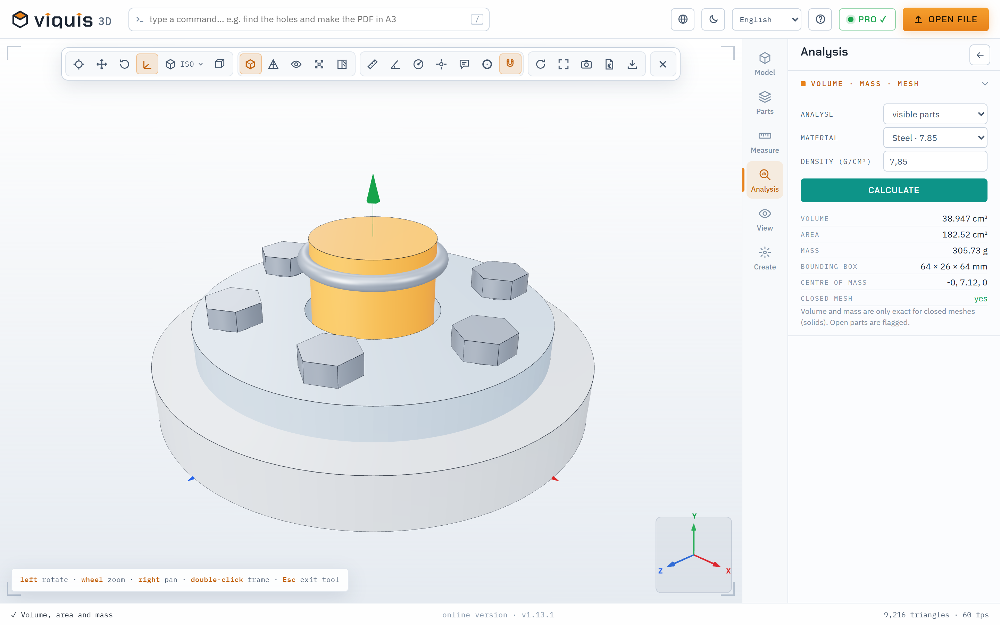
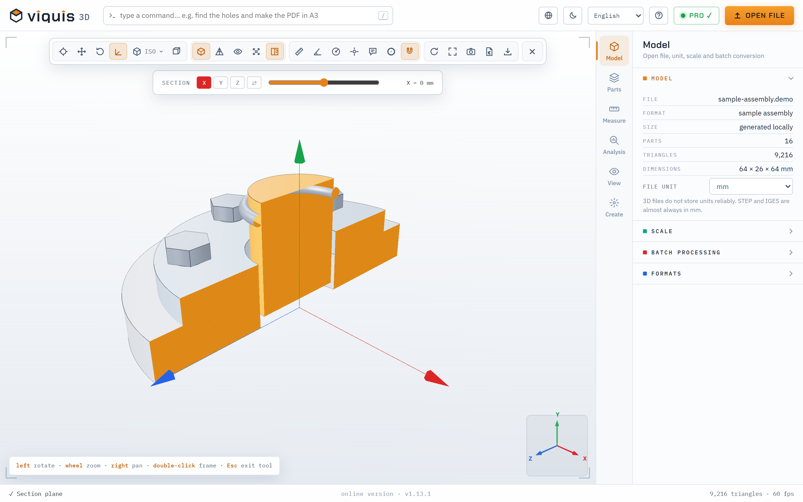
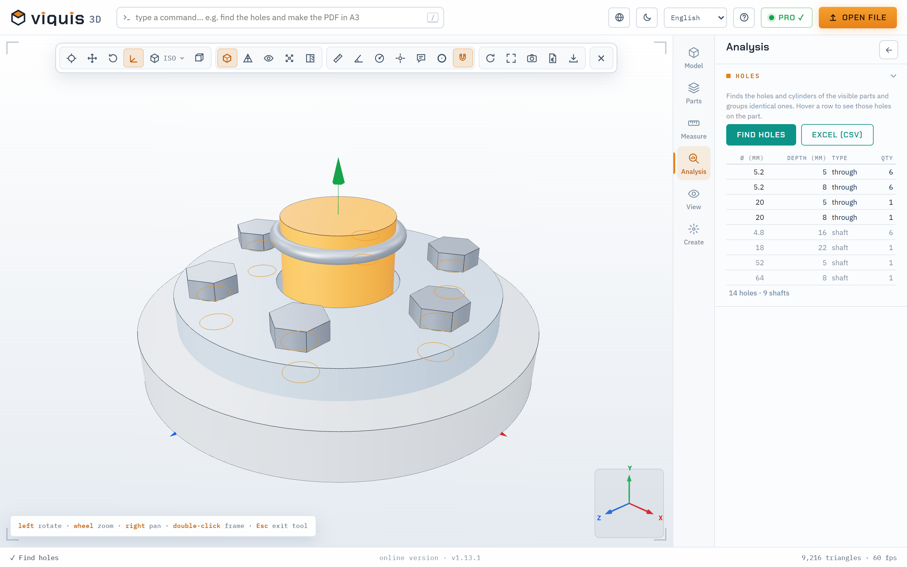

# Viquis 3D — STEP, STL and CAD viewer

**Open, measure and prepare any 3D part — in the browser or on Windows.**
Free to open files and take basic measurements. No sign-up. Your files never leave your computer.

[**Open the online app**](https://www.viquis.com/app/) · [**Download for Windows**](https://github.com/ritaraqueloliveira/viquis-3d/releases/latest) · [Microsoft Store](https://apps.microsoft.com/detail/9NV8X6810X74) · [Website](https://www.viquis.com/en/)

## What it does

- **Opens 17 formats:** STEP, IGES, BREP, STL, 3MF, OBJ, glTF, GLB, PLY, DAE, AMF, VRML, VTK, OFF, PCD, XYZ and G-code.
- **Measure:** distances, coordinates, angles, radii and diameters that snap to vertices; volume, area, mass in 15 materials and centre of mass.
- **Section:** a cutting plane in X, Y or Z that you drag by hand.
- **Assemblies:** exploded view, bill of materials with quantities and masses, parts isolated, hidden or see-through.
- **Holes:** every hole found on its own — diameter, depth, through or blind — and dimensioned on a PDF technical drawing.
- **3D printing:** overhangs, wall thickness, best orientation, cost and time, splitting into parts with alignment pins, a 3MF laid out on the bed, and a G-code viewer.
- **Create:** lithophanes, text and QR codes as STL.
- **Convert:** STEP → STL, OBJ, GLB, PLY or 3MF.

| Section view | Holes, found automatically |
|---|---|
|  |  |

## Free and Pro

Opening files and the basic measurements are free, with no time limit. **Pro** adds the analysis, drawing, quoting and conversion tools, and is unlocked with a licence key. You can try most Pro tools on the built-in sample assembly before buying. See [all features](https://www.viquis.com/en/features/) and [pricing](https://www.viquis.com/en/pricing/).

## Private by design

Files are opened and processed on your own computer, in the online version too. Nothing is uploaded. The only thing that leaves is the licence key, when you activate Pro. Details: [privacy](https://www.viquis.com/en/privacy/).

## Get it

| | |
|---|---|
| **Online** | <https://www.viquis.com/app/> — nothing to install; also works as an installable web app |
| **Windows installer** | [Latest release](https://github.com/ritaraqueloliveira/viquis-3d/releases/latest) (`Viquis-3D-Instalar-x.y.z.exe`) |
| **Microsoft Store** | <https://apps.microsoft.com/detail/9NV8X6810X74> |

The installer is not code-signed yet, so Windows may show a SmartScreen notice the first time you run it. See [requirements](https://www.viquis.com/en/requirements/) and [what's new](https://www.viquis.com/en/changelog/).

## Free online tools

[STEP viewer](https://www.viquis.com/en/tools/step-viewer/) · [STL viewer](https://www.viquis.com/en/tools/stl-viewer/) · [STEP to STL](https://www.viquis.com/en/tools/step-to-stl/) · [all tools](https://www.viquis.com/en/tools/)

## Languages

English, Português, Español, Français, Deutsch, Italiano, Nederlands, Polski, Čeština, Svenska, Türkçe, 日本語, 한국어, 中文 and Bahasa Indonesia.

## About this repository

This repository hosts the Windows installers of Viquis 3D (see [Releases](https://github.com/ritaraqueloliveira/viquis-3d/releases)). The program is proprietary; its source code is not published here. Questions and problems: <support@viquis.com>.
